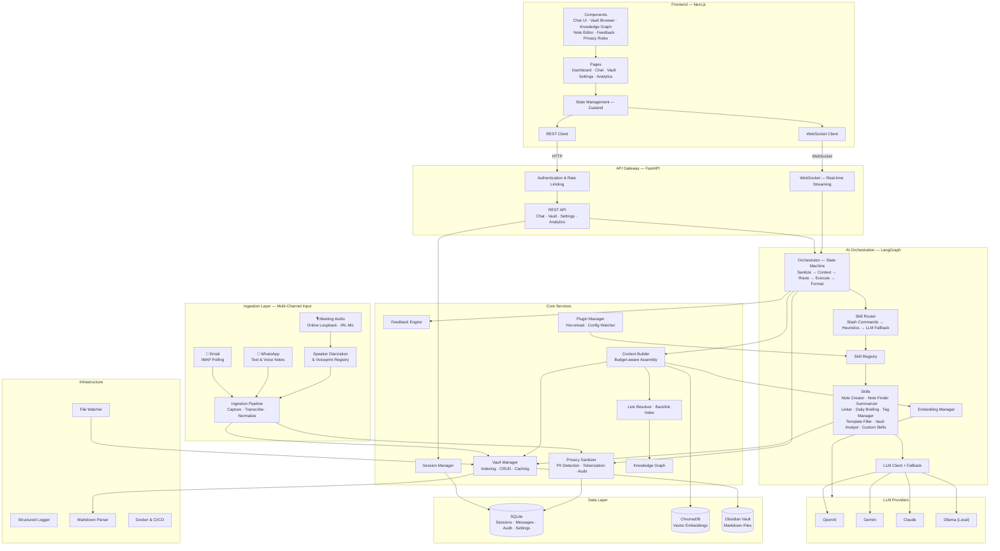
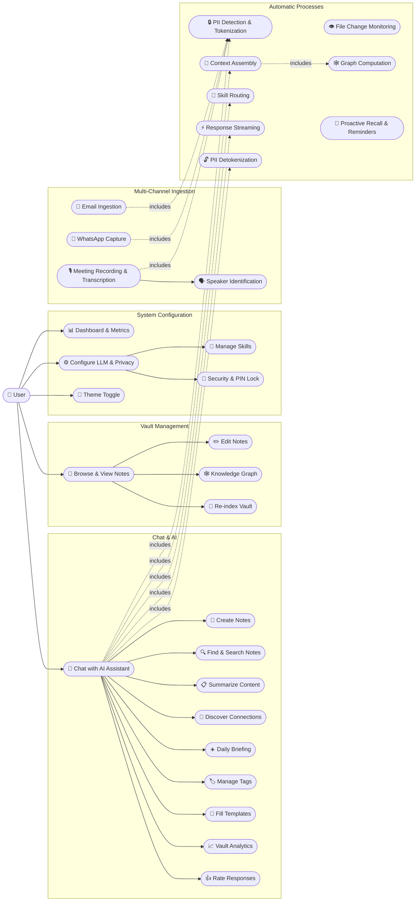
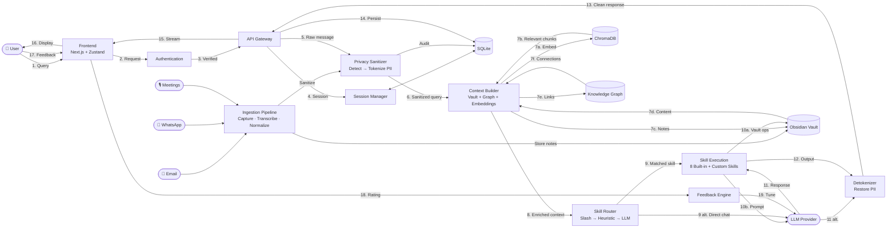
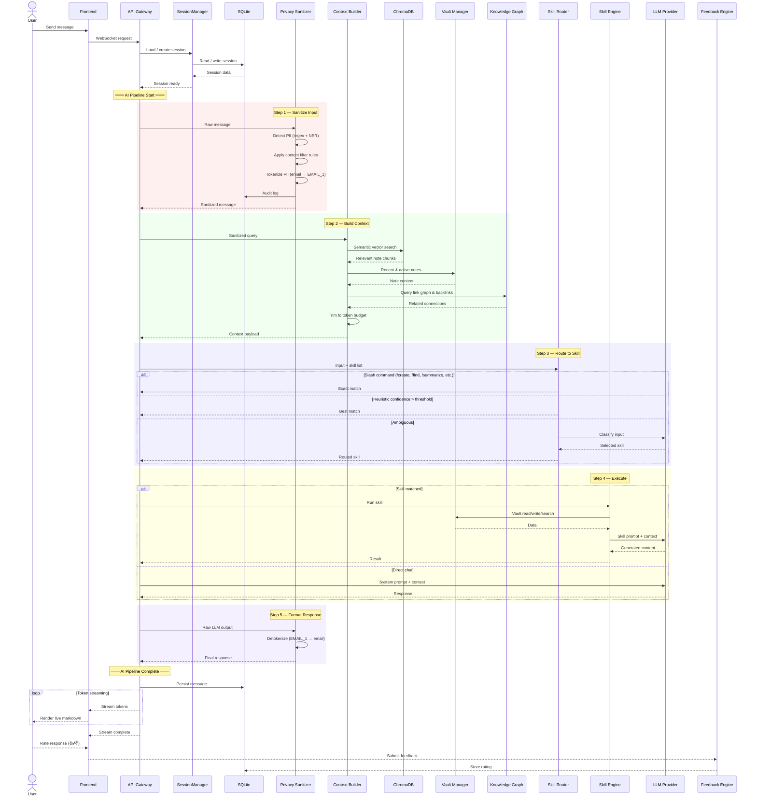

# Aurora — Architecture & Flow Diagrams (v2)

> Complete system overview — AI-Powered Obsidian Assistant

---

## 1. System Architecture Diagram

---

## 2. Use Case Diagram

---

## 3. Data Flow Diagram

---

## 4. Process Flow Diagram

