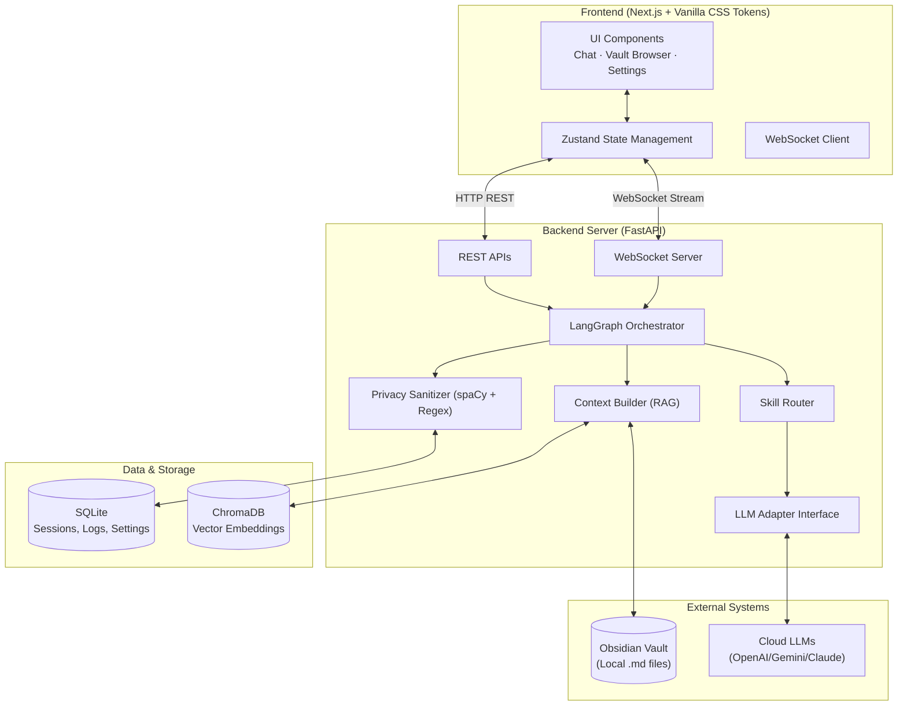
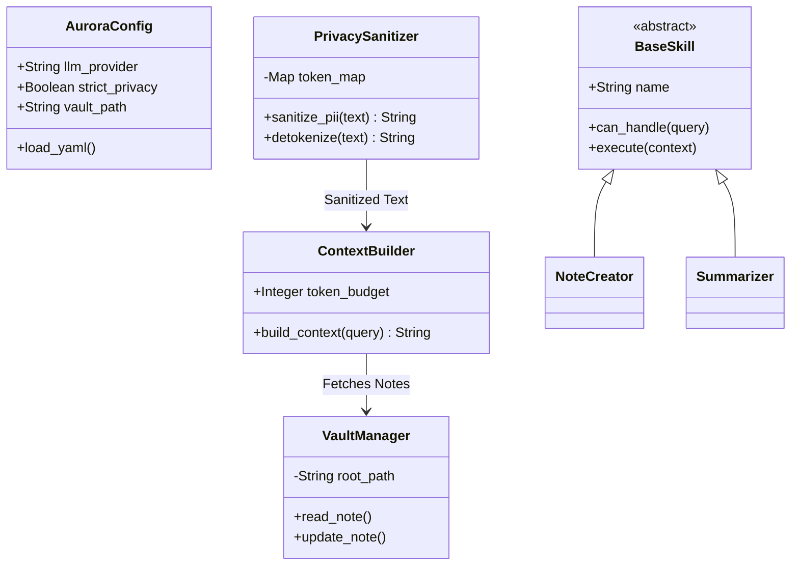
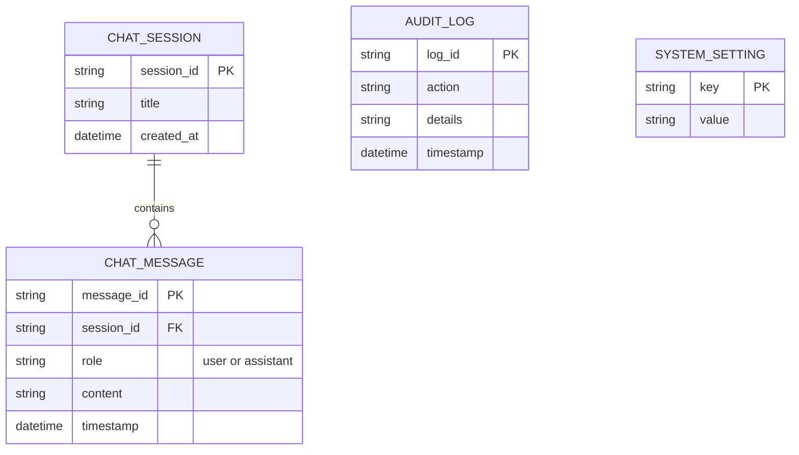
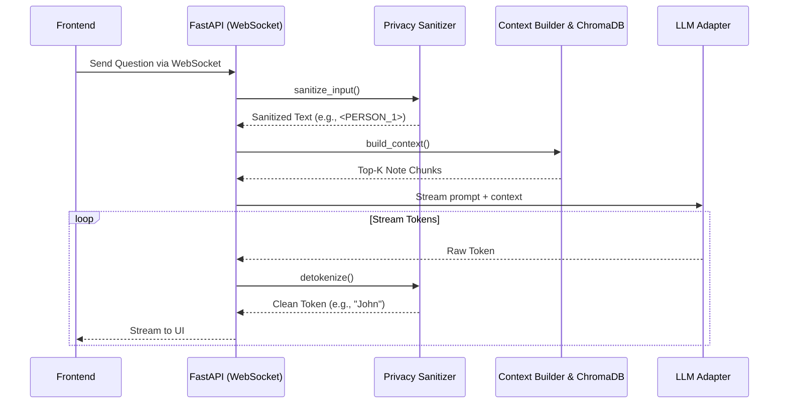
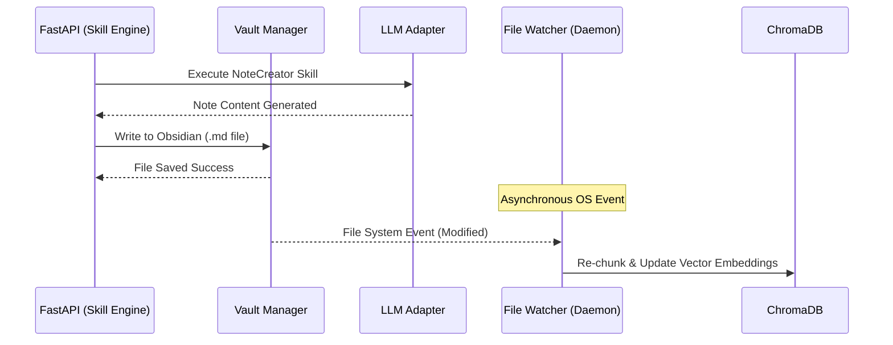
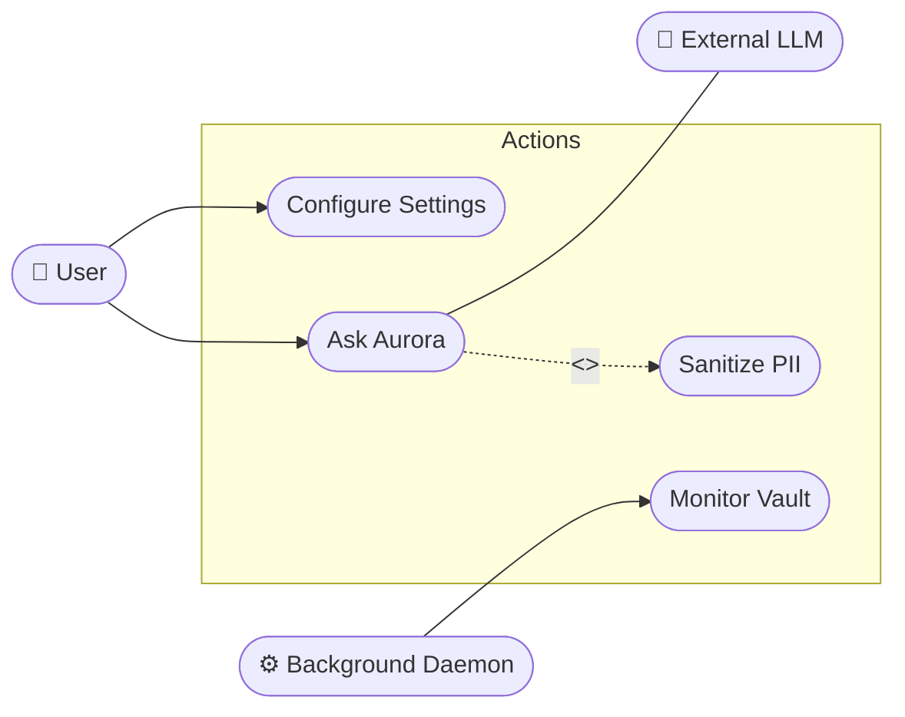

```mermaid
sequenceDiagram
    participant FW as File Watcher (watchdog)
    participant VM as Vault Manager
    participant EMB as Embedding Service
    participant VDB as ChromaDB

    FW->>VM: File Modified Event
    VM->>VM: Parse Markdown & Extract Chunks
    
    loop For each chunk
        VM->>EMB: Compute SHA-256 Hash
        alt Hash not in cache
            EMB->>EMB: Call Embedding Model
            EMB->>VDB: Upsert Vector
        else Hash in cache
            EMB-->>VM: Skip (Already Indexed)
        end
    end
```

# Imperfect Diagrams: Analysis and Corrections

This document analyzes the 7 imperfect diagrams found in the `docs/Imperfect images` directory. For each diagram, it explains the conceptual and architectural errors based on Aurora's actual codebase, and provides a corrected Mermaid diagram.

---

## 1. System Architecture Diagram
**What was wrong:**
1. **Redundancy:** It showed a "Cloud LLM APIs" block under External Services while simultaneously having an "LLM Service" block on the top right. 
2. **Wrong UI Stack:** Listed "Tailwind CSS". Aurora uses Vanilla CSS with a custom Design Token system.
3. **Missing WebSockets:** Showed only HTTP/REST (JSON) for responses, completely missing the WebSocket connection essential for real-time Markdown streaming.
4. **Library Misclassification:** Listed "Python Libraries (spaCy, LangGraph)" as External Services. These are internal backend dependencies, not external APIs.

**Corrected Diagram:**

---

## 2. Class Diagram
**What was wrong:**
1. **Fake Multi-Tenancy (RBAC):** It mapped out a complex Role-Based Access Control system (`GeneralUser`, `PowerUser`, `Administrator`). Aurora is a single-tenant local desktop assistant. There are no user roles.
2. **MongoDB Syntax:** It used `ObjectId` for all ID fields. Aurora uses SQLite (Integers/UUIDs) and ChromaDB.
3. **Database vs Application Logic:** It mixed relational database tables (like `AuditLog`) with in-memory application classes without distinguishing them.

**Corrected Diagram:**

---

## 3. ER (Entity-Relationship) Diagram
**What was wrong:**
1. **Unnecessary Tables:** Modeled `USER`, `ROLE`, and `SESSION (user_id)` tables. Since Aurora is local and single-user, complex user relationship tables are inaccurate.
2. **Mixing SQL and NoSQL:** Showed `VECTOR_STORE` as a relational table joined with Foreign Keys. ChromaDB is a vector database; it stores chunks and metadata, but it doesn't join relationally via SQL FKs to the `NOTE` table in SQLite.

**Corrected Diagram:**

*(Note: ChromaDB collections and Obsidian Markdown files are deliberately omitted as they are not SQLite relational entities).*

---

## 4. Sequence Diagram 1: Ask a Question (RAG)
**What was wrong:**
1. **Missing Orchestration:** Completely missed the LangGraph state machine flow and the Skill Router.
2. **Missing Privacy:** Failed to show the `sanitize_input` step before embedding, which is the core security feature of the app.
3. **No WebSockets:** Showed a single "Return generated response (text/JSON)" instead of token-by-token WebSocket streaming and detokenization.

**Corrected Diagram:**

---

## 5. Sequence Diagram 2: AI-Assisted Note Creation
**What was wrong:**
1. **Synchronous Embedding:** Showed LangGraph directly generating embeddings and saving to ChromaDB *after* saving the markdown file. In reality, saving the file triggers the OS `watchdog` daemon asynchronously to handle re-indexing. LangGraph doesn't block the AI response to generate embeddings manually.

**Corrected Diagram:**

---

## 6. Sequence Diagram 3: Vault Synchronization
**What was wrong:**
1. **Sanitizing the Index:** It showed the File Watcher passing vault notes through the "Privacy Processor (Sanitize PII)" *before* generating embeddings. If vault notes are tokenized in the database, semantic search breaks (searching for "Alice" won't match `<PERSON_1>`). Sanitization happens at *query time*, not *index time*.
2. **Missing Cache:** Missed the SHA-256 caching step which prevents redundant embedding generation.

**Corrected Diagram:**

---

## 7. Use Case Diagram
**What was wrong:**
1. **Humans triggering Automation:** "Power User" directly initiated "Detect Sensitive Data" and "Sanitize PII". Users don't do this manually; it's an automated background process `<<include>>`d in the chat flow.
2. **Admin doing Daemon work:** Showed "Administrator" manually initiating "Monitor Vault Changes" (File watching is automatic).
3. **LLM configuring the app:** Showed the external LLM Provider configuring `aurora.yaml`, which is logically impossible.

**Corrected Diagram:**
*(This matches the fixed diagram previously generated in `Fixed_UseCase_Diagram.md`)*

