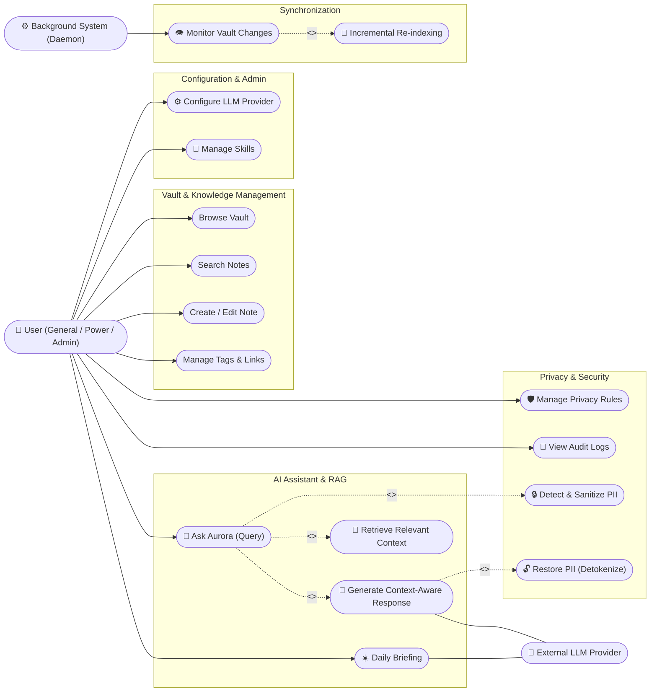

# Corrected Use Case Diagram

The original use case diagram had several fundamental UML and logical errors regarding how actors interact with the system. Here is a corrected version using Mermaid, followed by an explanation of the exact fixes made.

## Fixed Use Case Diagram

---

## What was wrong with the original diagram?

1. **Incorrect Actor Connections for Privacy:** 
   In your original diagram, the "Power User" directly initiated "Detect Sensitive Data" and "Sanitize PII". **Fix:** Users do not manually click a button to sanitize data. Sanitization is a background process that happens automatically when they chat. Therefore, "Detect & Sanitize PII" should be an `<<include>>` dependency stemming from the "Ask Aurora" use case.
2. **Incorrect Actor for Synchronization:**
   The "Administrator" was shown initiating "Monitor Vault Changes". **Fix:** A human administrator does not manually monitor the vault for file changes. This is done by the `watchdog` background service. I introduced a "Background System (Daemon)" actor to handle this automatic trigger, which then `<<include>>`s "Incremental Re-indexing".
3. **LLM Provider connected to Configuration:**
   The external "LLM Provider" (OpenAI/Gemini) was connected to "Select LLM Provider" and "Configure aurora.yaml". **Fix:** The LLM provider does not configure your app! It only receives prompts and generates responses. I disconnected the LLM Provider from the Config section and attached it purely to "Generate Context-Aware Response" and "Daily Briefing".
4. **"Used in AI Processing" is not a Use Case:**
   Use cases must be verbs/actions (e.g., "Retrieve Context", "Generate Response"). "Used in AI processing" is a vague state, not an action. **Fix:** I mapped the flow correctly so that "Ask Aurora" explicitly `<<include>>`s Context Retrieval, Sanitization, and Response Generation.
