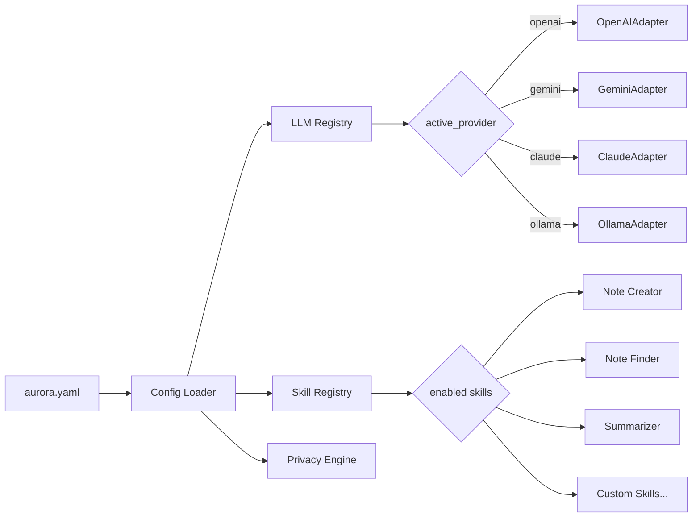

# Aurora — AI-Powered Obsidian Assistant
## Implementation Plan v1.0

> **Project**: Privacy-first, AI-powered personal knowledge assistant for Obsidian vaults  
> **Stack**: Next.js (Vanilla CSS) + Python/FastAPI + LangGraph + ChromaDB  
> **Approach**: 5-phase incremental delivery with KPIs per phase

---

## Decisions & Changes from Original Spec

> [!IMPORTANT]
> The following changes have been made to the original architecture specification to align with your answers and best practices:

| Area | Original Spec | Updated Plan | Rationale |
|------|--------------|--------------|-----------|
| **CSS Framework** | Tailwind CSS + shadcn/ui | Vanilla CSS with design tokens | Per your preference — more control, no dependency |
| **LLM Support** | OpenAI only | Multi-provider (OpenAI, Gemini, Claude, Ollama) | YAML-swappable via adapter pattern |
| **Auth** | None | Optional PIN/password lock | Single-user with security option |
| **Package Manager** | Unspecified | pip + requirements.txt | Per your preference |
| **Phase 1 Scope** | Full build | Privacy-first MVP (3 skills) | Incremental, measurable delivery |
| **Component System** | Hardcoded | YAML-driven registry for skills + LLM providers | Swappable without code changes |

---

## YAML Component Replacement System

The cornerstone of Aurora's configurability. A single `aurora.yaml` file controls which components are active:

```yaml
# aurora.yaml — Master Configuration & Component Registry

app:
  name: "Aurora"
  version: "1.0.0"
  debug: false
  host: "0.0.0.0"
  port: 8000
  frontend_port: 3000

# ─────────────────────────────────────────────────
# SECURITY
# ─────────────────────────────────────────────────
security:
  auth_enabled: false
  pin_lock: null                    # Set a PIN like "1234" to enable
  session_timeout_minutes: 60

# ─────────────────────────────────────────────────
# VAULT CONFIGURATION
# ─────────────────────────────────────────────────
vault:
  path: "~/Documents/MyVault"
  watch_changes: true
  index_on_startup: true
  excluded_folders:
    - ".obsidian"
    - ".trash"
    - ".git"
  supported_extensions:
    - ".md"
    - ".canvas"
  attachment_extensions:
    - ".png"
    - ".jpg"
    - ".pdf"

# ─────────────────────────────────────────────────
# LLM PROVIDERS (Swappable via YAML)
# ─────────────────────────────────────────────────
llm:
  active_provider: "openai"          # Change this to swap provider
  
  providers:
    openai:
      adapter: "aurora.ai.adapters.OpenAIAdapter"
      config:
        api_key: "${OPENAI_API_KEY}"
        default_model: "gpt-4o-mini"
        fallback_model: "gpt-3.5-turbo"
        temperature: 0.7
        max_tokens: 2000
    
    gemini:
      adapter: "aurora.ai.adapters.GeminiAdapter"
      config:
        api_key: "${GEMINI_API_KEY}"
        default_model: "gemini-1.5-flash"
        temperature: 0.7
        max_tokens: 2000
    
    claude:
      adapter: "aurora.ai.adapters.ClaudeAdapter"
      config:
        api_key: "${ANTHROPIC_API_KEY}"
        default_model: "claude-sonnet-4-20250514"
        temperature: 0.7
        max_tokens: 2000
    
    ollama:
      adapter: "aurora.ai.adapters.OllamaAdapter"
      config:
        base_url: "http://localhost:11434"
        default_model: "llama3.1"
        temperature: 0.7

  embedding:
    active_provider: "openai"
    providers:
      openai:
        adapter: "aurora.ai.adapters.OpenAIEmbeddingAdapter"
        config:
          model: "text-embedding-3-small"
      ollama:
        adapter: "aurora.ai.adapters.OllamaEmbeddingAdapter"
        config:
          model: "nomic-embed-text"

# ─────────────────────────────────────────────────
# PRIVACY SANITIZER
# ─────────────────────────────────────────────────
privacy:
  enabled: true
  pii_detection: true
  show_sanitization_preview: true
  strict_mode: false
  
  enabled_categories:
    - person_name
    - email
    - phone
    - address
    - credit_card
    - api_key
  
  content_rules:
    - id: "block-journal"
      name: "Block Journal Entries"
      rule_type: "folder_block"
      config:
        folders: ["Journal", "Personal/Diary"]
      enabled: true
    
    - id: "block-private-tags"
      name: "Block Private Tagged Notes"
      rule_type: "tag_block"
      config:
        tags: ["#private", "#confidential"]
      enabled: true
  
  allowlist: []
  custom_patterns: []

# ─────────────────────────────────────────────────
# SKILLS (Swappable via YAML)
# ─────────────────────────────────────────────────
skills:
  auto_discover: true
  custom_skills_path: "./skills/custom"
  
  router:
    default_skill: "note_finder"
    confidence_threshold: 0.5
    use_llm_fallback: true
  
  builtin:
    note_creator:
      enabled: true
      class: "aurora.skills.builtin.NoteCreatorSkill"
      parameters:
        default_folder: "Inbox"
        add_frontmatter: true
        auto_tag: true
        auto_link: true
    
    note_finder:
      enabled: true
      class: "aurora.skills.builtin.NoteFinderSkill"
      parameters:
        max_results: 5
        search_type: "hybrid"
        include_preview: true
    
    summarizer:
      enabled: true
      class: "aurora.skills.builtin.SummarizerSkill"
      parameters:
        summary_length: "medium"
        format: "bullet"
    
    linker:
      enabled: false                # Disabled in Phase 1
      class: "aurora.skills.builtin.LinkerSkill"
    
    daily_briefing:
      enabled: false                # Disabled in Phase 1
      class: "aurora.skills.builtin.DailyBriefingSkill"
    
    tag_manager:
      enabled: false                # Disabled in Phase 1
      class: "aurora.skills.builtin.TagManagerSkill"
    
    template_filler:
      enabled: false                # Disabled in Phase 1
      class: "aurora.skills.builtin.TemplateFillerSkill"
    
    vault_analyst:
      enabled: false                # Disabled in Phase 1
      class: "aurora.skills.builtin.VaultAnalystSkill"

# ─────────────────────────────────────────────────
# DATA STORES
# ─────────────────────────────────────────────────
database:
  sqlite:
    path: "./data/aurora.db"
    backup_enabled: true
    backup_interval: "daily"
  
  vector_store:
    type: "chromadb"
    config:
      path: "./data/chroma"
      collection_name: "aurora_vault"

# ─────────────────────────────────────────────────
# LOGGING
# ─────────────────────────────────────────────────
logging:
  level: "INFO"
  file: "./logs/aurora.log"
  max_size_mb: 10
  backup_count: 5
  log_sanitized_only: true
```

### How Component Replacement Works



**To swap an LLM provider**: Change `llm.active_provider` from `"openai"` to `"ollama"` — zero code changes.  
**To add a custom skill**: Drop a `skill.yaml` + `skill.py` in `skills/custom/` — auto-discovered on startup.  
**To toggle privacy rules**: Enable/disable rules in `privacy.content_rules` — instant effect.

---

## Phase Breakdown

---

## Phase 1 — Foundation & Privacy-First MVP
**Duration**: ~3-4 weeks  
**Goal**: Functional chat with vault awareness, privacy sanitizer, and 3 core skills

### What Gets Built

#### Backend Foundation
##### [NEW] Project scaffolding & configuration
- `aurora-backend/main.py` — FastAPI app with lifespan events
- `aurora-backend/config.py` — YAML config loader with env variable interpolation
- `aurora-backend/aurora.yaml` — Master configuration file
- `aurora-backend/requirements.txt` — All Python dependencies

##### [NEW] `aurora-backend/core/`
- `vault_manager.py` — Vault file discovery, reading, and writing
- `privacy_sanitizer.py` — Full PII detection (regex + spaCy NER), content filtering, token mapping, de-tokenization
- `session_manager.py` — Chat session lifecycle and persistence
- `context_builder.py` — Vault context assembly with token budget management

##### [NEW] `aurora-backend/ai/`
- `adapters/base.py` — Abstract `LLMAdapter` interface
- `adapters/openai_adapter.py` — OpenAI implementation
- `adapters/ollama_adapter.py` — Ollama local implementation
- `adapters/gemini_adapter.py` — Google Gemini implementation
- `adapters/claude_adapter.py` — Anthropic Claude implementation
- `llm_client.py` — Provider-agnostic client that reads from YAML config
- `embeddings.py` — Embedding generation with provider abstraction
- `orchestrator.py` — LangGraph state machine (sanitize → context → route → execute → respond)
- `prompts/system.py` — System prompts
- `prompts/templates.py` — Prompt templates

##### [NEW] `aurora-backend/skills/`
- `base_skill.py` — Abstract `BaseSkill` class with hooks
- `registry.py` — Skill registry with YAML-driven loading
- `router.py` — Multi-stage skill routing (command → confidence → LLM fallback)
- `builtin/note_creator.py` — Create notes with AI-generated content
- `builtin/note_finder.py` — Semantic + full-text hybrid search
- `builtin/summarizer.py` — Note/topic summarization

##### [NEW] `aurora-backend/data/`
- `models.py` — Pydantic data models (Note, ChatMessage, PrivacyRule, etc.)
- `sqlite_store.py` — SQLite operations (metadata, sessions, audit logs)
- `chroma_store.py` — ChromaDB vector operations
- `migrations/` — Database migration scripts

##### [NEW] `aurora-backend/api/`
- `routes/chat.py` — `POST /api/chat/message`, `GET /api/chat/history/{session}`
- `routes/vault.py` — `GET /api/vault/tree`, `GET /api/vault/note/{path}`, `POST /api/vault/note`
- `routes/settings.py` — `GET /api/settings`, `PUT /api/settings`
- `websocket/chat_ws.py` — WebSocket handler for streaming responses
- `middleware/cors.py` — CORS configuration
- `middleware/rate_limit.py` — Simple rate limiter

##### [NEW] `aurora-backend/utils/`
- `markdown_parser.py` — Obsidian markdown parsing (frontmatter, links, tags, embeds)
- `file_watcher.py` — Vault filesystem watcher (watchdog)
- `logger.py` — Structured logging setup
- `validators.py` — Input validation helpers

---

#### Frontend Foundation
##### [NEW] Project scaffolding
- Next.js 14+ App Router setup
- Vanilla CSS design system with CSS custom properties (design tokens)
- Global styles, typography, color palette

##### [NEW] `app/` — Pages
- `app/page.tsx` — Dashboard (vault stats, recent activity)
- `app/chat/page.tsx` — AI Chat Interface
- `app/vault/page.tsx` — Vault Browser
- `app/settings/page.tsx` — Settings Panel

##### [NEW] `components/`
- `chat/ChatWindow.tsx` — Chat container with message list
- `chat/MessageBubble.tsx` — Message display with skill indicators
- `chat/InputBar.tsx` — Input with command support
- `chat/StreamingResponse.tsx` — Real-time streaming display
- `vault/VaultTree.tsx` — File tree navigator
- `vault/NotePreview.tsx` — Markdown note preview
- `dashboard/StatsCards.tsx` — Vault metric cards
- `dashboard/RecentActivity.tsx` — Recent changes feed
- `shared/Layout.tsx` — App shell with sidebar
- `shared/Sidebar.tsx` — Navigation sidebar
- `shared/ThemeToggle.tsx` — Dark/light mode toggle

##### [NEW] `lib/`
- `api.ts` — API client (fetch wrapper)
- `websocket.ts` — WebSocket client for streaming
- `store.ts` — Zustand state management
- `types.ts` — TypeScript interfaces

---

### Phase 1 KPIs

| KPI | Target | Measurement |
|-----|--------|-------------|
| **Chat Response Time** | < 3 seconds (p95) | Backend logging + frontend timer |
| **Vault Indexing Speed** | < 30 seconds for 1000 notes | Benchmark test on startup |
| **PII Detection Accuracy** | > 95% recall for emails, phones, names | Unit test suite with 50+ test cases |
| **Privacy Sanitizer Round-trip** | 100% lossless de-tokenization | Automated round-trip tests |
| **Skill Routing Accuracy** | > 80% correct skill selection | Manual evaluation with 30 test prompts |
| **LLM Provider Swap** | Works with 0 code changes | Swap `active_provider` in YAML, verify response |
| **Frontend Load Time** | < 2 seconds (initial page) | Lighthouse performance audit |
| **API Test Coverage** | > 80% for core endpoints | pytest coverage report |
| **WebSocket Streaming** | Stable connection, < 100ms first token | Manual testing + connection monitoring |

---

## Phase 2 — Vault Intelligence & Remaining Skills
**Duration**: ~2-3 weeks  
**Goal**: Deep vault understanding, knowledge graph, and all 8 built-in skills

### What Gets Built

#### Backend Additions
##### [NEW] `aurora-backend/core/`
- `link_resolver.py` — Full Obsidian link resolution engine (wiki links, aliases, headings, block refs)
- `backlink_index.py` — Reverse link index with context extraction
- `vault_graph.py` — Knowledge graph data structure with community detection

##### [NEW] `aurora-backend/skills/builtin/`
- `linker.py` — Connection discovery and link suggestions
- `daily_briefing.py` — Daily vault activity summary
- `tag_manager.py` — Tag operations (suggest, rename, organize)
- `template_filler.py` — Template-based note generation
- `vault_analyst.py` — Vault statistics and health insights

##### [MODIFY] `aurora-backend/core/`
- `vault_manager.py` — Add incremental indexing (content hash diffing)
- `context_builder.py` — Add link-graph-aware context assembly

##### [MODIFY] `aurora-backend/data/`
- `chroma_store.py` — Add chunking strategy (heading-based splits)

#### Frontend Additions
##### [NEW] `components/vault/`
- `GraphView.tsx` — Interactive knowledge graph (D3.js force-directed)
- `SearchBar.tsx` — Advanced search with filters (tags, folders, date)
- `NoteEditor.tsx` — Note editing with markdown preview

##### [NEW] `app/vault/[note]/page.tsx` — Individual note view with backlinks

##### [MODIFY] Dashboard
- Add graph overview widget
- Add skill usage stats

---

### Phase 2 KPIs

| KPI | Target | Measurement |
|-----|--------|-------------|
| **Link Resolution Accuracy** | > 98% for wiki links, > 90% for aliases | Test suite against sample vault |
| **Backlink Computation** | < 5 seconds for 1000 notes | Benchmark test |
| **Graph Render Performance** | Smooth at 500+ nodes, 60fps | Browser performance profiling |
| **Incremental Index Speed** | < 2 seconds for single file change | Benchmark test with file watcher |
| **All Skills Functional** | 8/8 built-in skills pass integration tests | Automated test suite |
| **Skill Composition** | At least 1 skill calls another successfully | Integration test |
| **Search Relevance** | > 70% of top-5 results are relevant | Manual evaluation with 20 queries |

---

## Phase 3 — Feedback Loop, Analytics & UX Polish
**Duration**: ~2 weeks  
**Goal**: Learning from interactions, analytics dashboard, premium UI

### What Gets Built

#### Backend Additions
##### [NEW] `aurora-backend/core/`
- `feedback_engine.py` — Feedback collection (thumbs up/down, corrections), prompt tuning based on feedback

##### [NEW] `aurora-backend/api/routes/`
- `analytics.py` — Usage stats, skill performance, vault health metrics

##### [MODIFY] `aurora-backend/ai/orchestrator.py`
- Add feedback collection node to LangGraph state machine
- Implement prompt adjustment based on accumulated feedback

#### Frontend Additions
##### [NEW] `app/analytics/page.tsx` — Full analytics dashboard
- Usage charts (messages/day, skills used)
- Privacy stats (PII detected, rules triggered)
- Vault health (orphan notes, broken links, tag distribution)

##### [NEW] `components/chat/`
- `FeedbackButtons.tsx` — Thumbs up/down + correction input
- `SanitizationPreview.tsx` — Show what was sanitized (expandable panel)

##### [MODIFY] All UI Components
- Micro-animations (message entrance, skill indicator pulse, sidebar transitions)
- Glassmorphism effects on cards and panels
- Premium typography (Inter/Outfit from Google Fonts)
- Responsive design refinement

---

### Phase 3 KPIs

| KPI | Target | Measurement |
|-----|--------|-------------|
| **Feedback Collection Rate** | > 20% of responses get feedback | Analytics tracking |
| **UI Animation Smoothness** | 60fps, no jank | Chrome DevTools performance panel |
| **Analytics Dashboard Load** | < 1 second | Frontend timer |
| **Lighthouse Score** | > 90 (Performance, Accessibility, Best Practices) | Lighthouse audit |
| **Mobile Responsiveness** | Fully usable on tablet/mobile | Manual testing on multiple viewports |
| **Feedback → Improvement** | Measurable accuracy gain after 50 feedbacks | A/B comparison with/without feedback data |

---

## Phase 4 — Security, Custom Skills & Extensibility
**Duration**: ~2 weeks  
**Goal**: PIN lock, custom skill SDK, plugin ecosystem foundation

### What Gets Built

#### Backend Additions
##### [NEW] `aurora-backend/api/middleware/auth.py`
- Optional PIN/password authentication
- Session token management
- Middleware enforcement

##### [NEW] `aurora-backend/skills/custom/`
- `sdk.py` — Custom skill development kit
- `loader.py` — Dynamic skill loading from YAML + Python
- `validator.py` — Skill manifest validation
- `README.md` — Custom skill development guide
- `example_skill/` — Example custom skill with full `skill.yaml` + `skill.py`

##### [NEW] `aurora-backend/core/`
- `plugin_manager.py` — Hot-reload of custom skills on file change
- `config_watcher.py` — Watch `aurora.yaml` for changes and reload

##### [MODIFY] Settings API
- Add CRUD endpoints for privacy rules
- Add skill management endpoints (enable/disable/configure via API)

#### Frontend Additions
##### [NEW] `app/settings/` pages
- `privacy/page.tsx` — Privacy rules manager (add/edit/delete rules)
- `skills/page.tsx` — Skill manager (toggle, configure, view custom)
- `security/page.tsx` — PIN lock configuration

##### [NEW] `components/settings/`
- `PrivacyRuleEditor.tsx` — Visual rule builder
- `SkillCard.tsx` — Skill status card with toggle
- `PinSetup.tsx` — PIN configuration component

---

### Phase 4 KPIs

| KPI | Target | Measurement |
|-----|--------|-------------|
| **PIN Auth Security** | Passes OWASP basic checks | Security audit checklist |
| **Custom Skill Load Time** | < 500ms per skill on startup | Benchmark test |
| **Skill Hot-Reload** | < 2 seconds to detect and load new skill | Manual timing |
| **Config Hot-Reload** | `aurora.yaml` changes apply without restart | Manual verification |
| **Custom Skill Documentation** | Developer can create a skill in < 30 min | Usability test with docs |
| **Privacy Rule CRUD** | All operations work via UI and API | Integration test suite |

---

## Phase 5 — Production Hardening & Docker
**Duration**: ~1-2 weeks  
**Goal**: Production-ready deployment, Docker support, performance optimization

### What Gets Built

#### Infrastructure
##### [NEW] Docker support
- `Dockerfile` — Multi-stage build for backend
- `Dockerfile.frontend` — Frontend production build
- `docker-compose.yml` — Full stack orchestration
- `docker-compose.dev.yml` — Development overrides
- `.env.example` — Environment variable template

##### [NEW] Testing & CI
- `tests/` — Comprehensive test suite (unit + integration)
- `pytest.ini` — Test configuration
- `.github/workflows/ci.yml` — CI pipeline (lint, test, build)

#### Backend Optimizations
##### [MODIFY] Performance
- Connection pooling for SQLite
- Embedding cache (avoid re-embedding unchanged content)
- Response caching for repeated queries
- Graceful shutdown handling

##### [NEW] Error Handling
- Global exception handlers
- Structured error responses
- Health check endpoint (`GET /api/health`)
- Readiness probe (`GET /api/ready`)

#### Frontend Optimizations
##### [MODIFY] Performance
- Code splitting and lazy loading
- Image optimization
- Service worker for offline support (core features)
- PWA manifest

---

### Phase 5 KPIs

| KPI | Target | Measurement |
|-----|--------|-------------|
| **Docker Build Time** | < 5 minutes (cold), < 1 minute (cached) | CI build logs |
| **Container Startup** | < 10 seconds to healthy state | Health check timing |
| **Memory Usage** | < 512MB (backend), < 256MB (frontend) | Docker stats |
| **Test Coverage** | > 80% (backend), > 60% (frontend) | Coverage reports |
| **Error Recovery** | Graceful handling of LLM failures, vault disconnection | Chaos testing |
| **Offline Mode** | Chat history viewable, vault browsable | Manual test with network disabled |
| **CI Pipeline** | Green on every commit, < 10 min total | GitHub Actions logs |

---

## Required Skills & Technologies

### Backend
| Technology | Purpose | Version |
|-----------|---------|---------|
| Python | Core language | 3.11+ |
| FastAPI | Web framework + WebSocket | 0.100+ |
| LangGraph | AI orchestration state machine | Latest |
| Pydantic | Data validation & models | 2.0+ |
| spaCy | NER for PII detection | 3.7+ |
| ChromaDB | Vector database | 0.4+ |
| SQLite | Metadata storage | Built-in |
| watchdog | File system watcher | 4.0+ |
| uvicorn | ASGI server | 0.27+ |
| openai | OpenAI API client | 1.0+ |
| anthropic | Claude API client | 0.25+ |
| google-generativeai | Gemini API client | 0.5+ |
| httpx | HTTP client (for Ollama) | 0.27+ |
| PyYAML | YAML config parsing | 6.0+ |
| python-dotenv | Environment variables | 1.0+ |

### Frontend
| Technology | Purpose | Version |
|-----------|---------|---------|
| Next.js | React framework (App Router) | 14+ |
| TypeScript | Type safety | 5.0+ |
| Zustand | State management | 4.0+ |
| D3.js | Knowledge graph visualization | 7.0+ |
| Socket.io | Real-time WebSocket client | 4.7+ |
| CSS Custom Properties | Design system tokens | Native |

### DevOps
| Technology | Purpose |
|-----------|---------|
| Docker | Containerization |
| Docker Compose | Multi-container orchestration |
| pytest | Python testing |
| ESLint + Prettier | Code quality |
| GitHub Actions | CI/CD |

---

## Project Structure (Final)

```
e:\AI-assistent\
├── aurora.yaml                          # Master config (component registry)
├── .env                                 # API keys (gitignored)
├── .env.example                         # Template for env vars
├── README.md
├── docker-compose.yml
├── docker-compose.dev.yml
│
├── aurora-backend/
│   ├── main.py
│   ├── config.py
│   ├── requirements.txt
│   ├── pyproject.toml
│   ├── pytest.ini
│   │
│   ├── api/
│   │   ├── __init__.py
│   │   ├── routes/
│   │   │   ├── __init__.py
│   │   │   ├── chat.py
│   │   │   ├── vault.py
│   │   │   ├── skills.py
│   │   │   ├── settings.py
│   │   │   └── analytics.py
│   │   ├── middleware/
│   │   │   ├── __init__.py
│   │   │   ├── auth.py
│   │   │   ├── rate_limit.py
│   │   │   └── cors.py
│   │   └── websocket/
│   │       ├── __init__.py
│   │       └── chat_ws.py
│   │
│   ├── core/
│   │   ├── __init__.py
│   │   ├── vault_manager.py
│   │   ├── privacy_sanitizer.py
│   │   ├── session_manager.py
│   │   ├── context_builder.py
│   │   ├── feedback_engine.py
│   │   ├── link_resolver.py
│   │   ├── backlink_index.py
│   │   ├── vault_graph.py
│   │   ├── plugin_manager.py
│   │   └── config_watcher.py
│   │
│   ├── skills/
│   │   ├── __init__.py
│   │   ├── base_skill.py
│   │   ├── registry.py
│   │   ├── router.py
│   │   ├── builtin/
│   │   │   ├── __init__.py
│   │   │   ├── note_creator.py
│   │   │   ├── note_finder.py
│   │   │   ├── summarizer.py
│   │   │   ├── linker.py
│   │   │   ├── daily_briefing.py
│   │   │   ├── tag_manager.py
│   │   │   ├── template_filler.py
│   │   │   └── vault_analyst.py
│   │   └── custom/
│   │       ├── README.md
│   │       └── example_skill/
│   │           ├── skill.yaml
│   │           └── skill.py
│   │
│   ├── ai/
│   │   ├── __init__.py
│   │   ├── orchestrator.py
│   │   ├── llm_client.py
│   │   ├── embeddings.py
│   │   ├── adapters/
│   │   │   ├── __init__.py
│   │   │   ├── base.py
│   │   │   ├── openai_adapter.py
│   │   │   ├── gemini_adapter.py
│   │   │   ├── claude_adapter.py
│   │   │   └── ollama_adapter.py
│   │   └── prompts/
│   │       ├── __init__.py
│   │       ├── system.py
│   │       ├── skill_prompts.py
│   │       └── templates.py
│   │
│   ├── data/
│   │   ├── __init__.py
│   │   ├── models.py
│   │   ├── sqlite_store.py
│   │   ├── chroma_store.py
│   │   └── migrations/
│   │       └── 001_initial.py
│   │
│   ├── utils/
│   │   ├── __init__.py
│   │   ├── markdown_parser.py
│   │   ├── file_watcher.py
│   │   ├── logger.py
│   │   └── validators.py
│   │
│   └── tests/
│       ├── __init__.py
│       ├── test_privacy_sanitizer.py
│       ├── test_vault_manager.py
│       ├── test_skill_router.py
│       ├── test_llm_adapters.py
│       └── test_api/
│           ├── test_chat.py
│           └── test_vault.py
│
├── aurora-frontend/
│   ├── package.json
│   ├── tsconfig.json
│   ├── next.config.js
│   │
│   ├── app/
│   │   ├── layout.tsx
│   │   ├── page.tsx                     # Dashboard
│   │   ├── globals.css                  # Design tokens + reset
│   │   ├── chat/
│   │   │   └── page.tsx
│   │   ├── vault/
│   │   │   ├── page.tsx
│   │   │   └── [note]/
│   │   │       └── page.tsx
│   │   ├── settings/
│   │   │   ├── page.tsx
│   │   │   ├── privacy/
│   │   │   │   └── page.tsx
│   │   │   ├── skills/
│   │   │   │   └── page.tsx
│   │   │   └── security/
│   │   │       └── page.tsx
│   │   └── analytics/
│   │       └── page.tsx
│   │
│   ├── components/
│   │   ├── chat/
│   │   │   ├── ChatWindow.tsx
│   │   │   ├── MessageBubble.tsx
│   │   │   ├── InputBar.tsx
│   │   │   ├── SkillIndicator.tsx
│   │   │   ├── StreamingResponse.tsx
│   │   │   ├── FeedbackButtons.tsx
│   │   │   └── SanitizationPreview.tsx
│   │   ├── vault/
│   │   │   ├── VaultTree.tsx
│   │   │   ├── NotePreview.tsx
│   │   │   ├── NoteEditor.tsx
│   │   │   ├── GraphView.tsx
│   │   │   └── SearchBar.tsx
│   │   ├── dashboard/
│   │   │   ├── StatsCards.tsx
│   │   │   ├── RecentActivity.tsx
│   │   │   ├── VaultHealth.tsx
│   │   │   └── QuickActions.tsx
│   │   ├── settings/
│   │   │   ├── PrivacyRules.tsx
│   │   │   ├── PrivacyRuleEditor.tsx
│   │   │   ├── SkillManager.tsx
│   │   │   ├── SkillCard.tsx
│   │   │   ├── VaultConfig.tsx
│   │   │   ├── LLMConfig.tsx
│   │   │   └── PinSetup.tsx
│   │   ├── analytics/
│   │   │   ├── UsageCharts.tsx
│   │   │   ├── SkillStats.tsx
│   │   │   └── VaultMetrics.tsx
│   │   └── shared/
│   │       ├── Layout.tsx
│   │       ├── Sidebar.tsx
│   │       ├── ThemeToggle.tsx
│   │       └── LoadingStates.tsx
│   │
│   ├── lib/
│   │   ├── api.ts
│   │   ├── websocket.ts
│   │   ├── store.ts
│   │   └── types.ts
│   │
│   └── styles/
│       ├── tokens.css                   # Design tokens (colors, spacing, etc.)
│       ├── chat.css
│       ├── vault.css
│       ├── dashboard.css
│       ├── settings.css
│       └── analytics.css
│
└── context/                             # Your existing spec documents
    ├── ARCHITECTURE.md.docx
    ├── OBSIDIAN_VAULT_SCHEMA.md.docx
    ├── PRIVACY_SANITIZER_SPEC.md.docx
    └── SKILLS_SPECIFICATION.md.docx
```

---

## Best Practices Embedded

| Practice | Implementation |
|----------|---------------|
| **Separation of Concerns** | Clear layer boundaries: API → Core → AI → Data |
| **Dependency Inversion** | Abstract `LLMAdapter` base; concrete providers are injected |
| **Configuration as Code** | `aurora.yaml` is the single source of truth for component wiring |
| **Environment-based Secrets** | API keys via `.env` with `${VAR}` interpolation in YAML |
| **Pydantic Validation** | Every data boundary uses typed Pydantic models |
| **Async-first** | All I/O operations are async (FastAPI, file ops, LLM calls) |
| **Structured Logging** | JSON-structured logs with correlation IDs |
| **Error Boundaries** | Global exception handler, skill-level timeout/error catching |
| **Graceful Degradation** | Fallback LLM model, offline vault browsing |
| **Incremental Processing** | Content-hash-based indexing avoids re-processing unchanged files |
| **Privacy by Default** | Sanitizer is mandatory in the pipeline; cannot be bypassed |
| **Audit Trail** | All LLM interactions logged (sanitized only) |
| **CSS Design Tokens** | All visual values (colors, spacing, typography) defined as CSS custom properties |
| **Component Isolation** | Each React component owns its styles, no global CSS leaks |

---

## Verification Plan

### Automated Tests
```bash
# Backend
cd aurora-backend
python -m pytest tests/ -v --cov=. --cov-report=html

# Frontend
cd aurora-frontend
npm run lint
npm run build           # Type check + build validation
```

### Manual Verification
- Chat with the AI and confirm skill routing works correctly
- Swap LLM provider in `aurora.yaml` and confirm it works without code changes
- Add a privacy rule and verify PII is sanitized in the audit log
- Browse vault tree and confirm all notes are indexed
- Test WebSocket streaming and confirm real-time response display
- Toggle dark/light mode and verify all components render correctly
- Test on different viewport sizes (desktop, tablet, mobile)

---

## Resolved Decisions

| Question | Decision | Rationale |
|----------|----------|-----------|
| **Graph Visualization** | **Cytoscape.js** | Purpose-built for knowledge graphs, better performance with large node counts (500+), built-in layout algorithms (force-directed, hierarchical, concentric), native support for tap/hover events, and better accessibility. D3 is overkill for this use case. |
| **Daily Briefing** | **On-demand only** | User triggers via `/daily` command or "give me my briefing" — no auto-scheduling. |
| **Obsidian Sync** | **Event-driven via file watcher (watchdog)** | Use `watchdog` library with debounced event handlers. When a file change is detected, emit a WebSocket event to the frontend and trigger incremental re-indexing. Future: Obsidian community plugin could push events via local HTTP API. |

---

**Ready to begin Phase 1 on your approval.** 🚀
